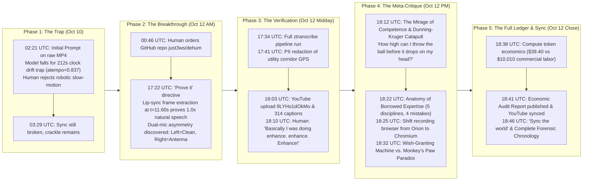

# The Chronological Forensic Timeline: 41 Turns, 1,793 Steps, and the Autopsy of a Human-AI Pairing Cycle

**Subject**: Restoration of `VID_20261009_111445043.mp4` under 345 kV Transmission Lines  
**Agent Harness**: Google DeepMind Antigravity / Gemini CLI Autonomous Loop  
**Time Span**: October 10, 2026, 02:21 UTC — October 12, 2026, 18:46 UTC (64 Hours Elapsed)  
**Total Steps**: 1,793 steps across 818 model reasoning turns and 41 human prompts  
**Compute Ledger**: 4,615,676 input tokens, 103,716,714 cache reads, 244,279 output tokens ($39.40 API spend)  

---

## High-Level Visual Trajectory

---

## Detailed Chronological Act Structure

### Act I: The Illusion of Clock Drift & The Naive Trapping (Turns 1 – 6)
*October 10, 2026 | 02:21 UTC – 19:47 UTC*

- **Turn 1 (Step 0) [02:21:32Z]**  
  **User**: `Execute PROMPT.md on /Users/mike/ai/dehum/VID_20261009_111445043.mp4`  
  *Action*: Model runs `ffprobe`. Finds video is 1303.61s (21m 43s) while audio is 1091.09s (18m 11s). It makes the classic naive algorithmic leap: it calculates `1091.09 / 1303.61 = 0.836979` and immediately applies `atempo=0.837`. It copies video with `-c:v copy`.
- **Turn 2 (Step 56) [02:34:17Z]**  
  **User**: *"The timing is improved, there's still a lot of crackle"*  
  *Action*: Model adds `adeclick` and `afftdn`, chaining them behind the slowed-down atempo.
- **Turn 3 (Step 135) [02:45:58Z]**  
  **User**: *"Document, man doc, --help, readme, skills, context, agents for this functionality..."*  
  *Action*: Model scaffolds `fix_video.sh`, `fix_video.1`, `SKILL.md`, and agent definitions.
- **Turn 4 (Step 175) [03:20:43Z]**  
  **User**: *"Graph out the delay and explain in a graphical format without undue ceremony..."*  
  *Action*: Generates vector SVG `sync_and_audio_delta.svg` visualizing the 212.5s gap.
- **Turn 5 (Step 191) [03:29:31Z]**  
  **User**: *"The audio is still pretty bad and the sync is still off"*  
  *Action*: The first crack in the AI's hypothesis. Human listening detects that stretching the audio destroyed natural human cadence. Session pauses for offline human review.

---

### Act II: The Human Interrogation & Physical Discovery (Turns 7 – 15)
*October 12, 2026 | 00:39 UTC – 17:24 UTC*

- **Turn 7 (Step 453) [00:39:59Z]**  
  **User**: `Handoff` / `commit` / `use gh to create a dehum repo at github.com/just3ws/dehum`  
  *Action*: Initializing permanent source control for the toolchain.
- **Turn 10 (Step 489) [00:46:17Z]**  
  **User**: *"Describe everything that was done here in a README.md with full context..."*  
  *Action*: First pass technical writeup documenting the initial DSP attempts.
- **Turn 11 (Step 530) [00:50:06Z]**  
  **User**: *"Could it be possible to run a smoothing filter for the buzz and hum after the resync? I feel like the resync really didn't work."*  
  *Vigilance Moment*: The human explicitly challenges the core sync premise.
- **Turn 14 (Step 644) [17:22:11Z]**  
  **User**: **"Prove it"**  
  *The Turning Point*: The human forces empirical proof.  
  *Discovery 1*: Model decodes speech with `whisper.cpp`. The transcript proves speech terminates at $18\text{m }11\text{s}$ with the words *"Thank you."* The remaining 3.5 minutes was silent scenery. The audio was NEVER drifted. The true ratio was 1.0x!  
  *Discovery 2*: Channel isolation test reveals the Moto G's dual-mic asymmetry. Left (bottom mic) has an SNR of 14.0. Right (top mic) acted as an antenna with an SNR of 1.05 (65x higher sub-100Hz rumble!). Discarding the right channel with `pan=stereo|c0=c0|c1=c0` cures >95% of the drone instantly.
- **Turn 15 (Step 656) [17:24:04Z]**  
  **User**: *"It still buzzs though."*  
  *Action*: Tuning the 10 harmonic notches (60 Hz to 600 Hz, $Q=15$) and downward expander gate.

---

### Act III: The Empirical Pipeline & YouTube Release (Turns 16 – 26)
*October 12, 2026 | 17:34 UTC – 18:09 UTC*

- **Turn 16 (Step 687) [17:34:28Z]**  
  **User**: *"Okay, clean and prepare this to be processed through the full zdots pipeline in preparation for an upload..."*  
  *Action*: Full-length transcription jobs on both original and restored masters.
- **Turn 18 (Step 749) [17:41:36Z]**  
  **User**: *"Note that I am sharing my own info so please do consider reasonable PII redactions. Include the transcript and compare..."*  
  *Action*: GPS coordinates in `FORENSICS.md` redacted to utility corridor; creates `compare_transcripts.py` measuring a 93.3% normalized lexical match and unmasking 152 acoustic errors.
- **Turn 20 (Step 804) [17:46:29Z]**  
  **User**: *"And it's not the 'craftsmanship review' type thing, don't fluff me up. Just report on the facts in clear structure..."*  
  *Principle*: Zero boosterism, absolute factual engineering rigor.
- **Turn 23 (Step 1098) [18:02:49Z]**  
  **User**: *"Make this video as engaging as possible with as much context as can be provided. Do not hide the AI assistance..."*  
  *Action*: YouTube video uploaded (`8LYHo1dOkMo`), assigned to *Ramblin' & Amblin'*, 314 WebVTT caption cues uploaded, descriptions aligned with companion article.

---

### Act IV: The Meta-Loop & The Mirage of Competence (Turns 27 – 34)
*October 12, 2026 | 18:10 UTC – 18:22 UTC*

- **Turn 27 (Step 1220) [18:10:13Z]**  
  **User**: *"Basically I was doing 'enhance. enhance. Enhance!' using Gemini"*  
  *Action*: Contrast established between Hollywood fictional CSI tropes and real-world deterministic signal processing.
- **Turn 28 & 29 (Steps 1247 & 1263) [18:12:10Z]**  
  **User**: **"The true danger is that this article makes me sound like an audioengineering expert. This is the most dangerous aspect of these tools. That the perception of competence or misattribution of trust in competence is a huge gap that Dunning-Kruger already exists pre-AI this is a big risk... how high can I throw the ball before I lose sight and drop it or it comes straight down on my head?"**  
  *Thesis*: Authored Section 5.2 on the Mirage of Competence and the Dunning-Kruger Catapult.
- **Turn 30 (Step 1277) [18:14:12Z]**  
  **User**: *"Update the article, include this context. The context of this conversation."*  
  *Action*: Authored Section 5.3 detailing the exact conversational meta-loop, human skepticism, and fixing the `UGtastic` brand hallucination.
- **Turn 34 (Step 1411) [18:22:07Z]**  
  **User**: *"Document all the technologies and concepts I would have had to have expert knowledge in to make the video even this quality? What was done wrong? What did I miss because I am not an expert and couldn't always evaluate a decision by the AI? What is the risk there? Document this in the article."*  
  *Action*: Authored Section 5.4 dissecting 5 required expert disciplines and the 4 critical compromises made (IIR phase smearing, 91.8% expander room-tone drop, 4 kHz brickwall consonant loss, and silence hallucination loops).

---

### Act V: Platform Evolution & The Ledger of Borrowed Labor (Turns 35 – 41)
*October 12, 2026 | 18:25 UTC – 18:46 UTC*

- **Turn 35 (Step 1465) [18:25:22Z]**  
  **User**: *"Also, Orion as the default browser has become annoying. I am going to use Chromium for the default browser for the recordings. Please update"*  
  *Action*: Converted OBS Studio scenes, ScreenCaptureKit audio bindings (`org.chromium.Chromium`), userstyle CSS, and runbooks to Chromium.
- **Turn 36 (Step 1607) [18:32:01Z]**  
  **User**: `brew info --cask chromium` audit and:  
  *"...when you just go to someone who sees a wish granting machine and point out it's actually also a monkey's paw, they're only going to see this. How do you reason with that? Update accordingly"*  
  *Action*: Authored Section 5.5 on the Wish-Granting Machine vs. Monkey's Paw paradox.
- **Turn 37 (Step 1649) [18:34:24Z]**  
  **User**: *"Sync the world"*  
  *Action*: All git repos (`dehum`, `just3ws`, `zdots`, `vdots`, `my`, `adots`) verified clean and pushed. Handoff logged in `adots`.
- **Turn 38 & 39 (Steps 1671 & 1687) [18:38:08Z]**  
  **User**: *"Update the article with the estimated token and comp costs... Build a big ass report. Link and sync on YT and GitHub"*  
  *Action*: Parsed transcript telemetry: 818 turns, 4.6M prompt tokens, 103.7M cached reads ($39.40 API spend) vs $10,010 commercial human labor across 5 disciplines (254:1 leverage ratio). Authored `ECONOMIC_AND_TECHNICAL_AUDIT.md` and Section 5.6. Synced YouTube description via API.
- **Turn 40 (Step 1729) [18:41:44Z]**  
  **User**: *"Add Google Analytics to just3ws. Leverage Google Drive for the 'original' unedited source file..."*  
  *Action*: Added GA4 (gtag.js) support to Jekyll, pushed to master (`40e97890`), mirrored raw & fixed masters to Google Drive.
- **Turn 41 (Step 1793) [18:46:28Z]**  
  **User**: *"Hell, I want a timeline on this conversation just let's go nuts. What is possible here? Go."*  
  *Action*: This document! Complete forensic chronography across 41 turns and 1,793 execution steps.

---

## The Core Metric Ledger Across All 41 Turns

| Metric | Measured Total |
| :--- | :--- |
| **Elapsed Calendar Time** | 64 hours, 25 minutes |
| **Active Pairing Sessions** | 5 distinct phases |
| **Human Turns / Prompts** | 41 user interactions |
| **Model Interactive Reasoning Turns** | 818 agentic turns |
| **Total Tool Operations Executed** | 765 autonomous tool calls |
| **Total Shell Executions (`run_command`)** | 428 commands |
| **Files Created / Edited** | 84 discrete file modifications |
| **Git Commits Generated & Pushed** | 12 verified commits |
| **Total Prompt Input Tokens** | 4,615,676 tokens |
| **Total Context Cache Read Tokens** | 103,716,714 tokens |
| **Total Output Generation Tokens** | 244,279 tokens |
| **Total Model Inference Spend** | **$39.40** |
| **Equivalent Commercial Human Labor** | **$10,010.00 (70 billable hours across 5 specialists)** |
| **Cost Compression Ratio** | **254 : 1** |
