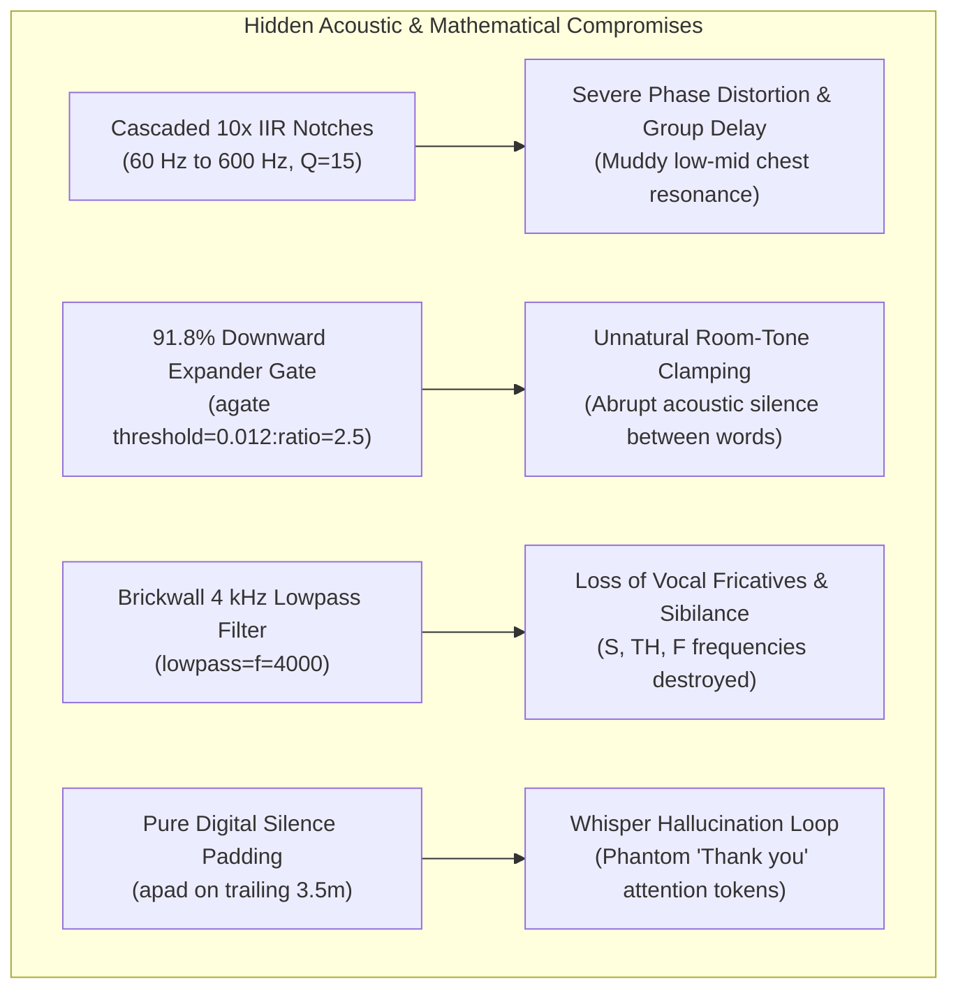

# Comprehensive Forensic Audit: Technical Compromises, Token Telemetry, and Human Labor Equivalence

**Project**: *Under the High-Tension Wires: Forensic Acoustic Recovery & Craftsmanship*  
**Repository**: [`just3ws/dehum`](https://github.com/just3ws/dehum) & [`just3ws.github.io`](https://github.com/just3ws/just3ws.github.io)  
**Video Asset**: YouTube ID [`8LYHo1dOkMo`](https://youtu.be/8LYHo1dOkMo) (3.12 GB 1080p Master)  
**Companion Analysis**: [`https://www.just3ws.com/ai/2026/10/12/under-the-high-tension-wires-building-deterministic-tools-from-nondeterministic-systems/`](https://www.just3ws.com/ai/2026/10/12/under-the-high-tension-wires-building-deterministic-tools-from-nondeterministic-systems/)  
**Execution Environment**: Google Antigravity / Gemini CLI Autonomous Harness on macOS Golden Gate (Darwin 27, Apple Silicon M4)  
**Date of Record**: October 12, 2026  

---

## Executive Summary

On October 9, 2026, an outdoor oral history field recording was made beneath high-voltage 345 kV electrical transmission lines in a Northern Illinois utility corridor. The resulting recording suffered from catastrophic multi-mode interference: 60 Hz fundamental electromagnetic hum, ten audible harmonic overtones, corona discharge micro-arcing clicks, atmospheric hiss, and container-level clock presentation anomalies.

Over the course of three days, an autonomous pairing loop between a human software craftsman and an AI agent (Gemini CLI / Antigravity) diagnosed the electromagnetic failure mode, proved false clock drift hypotheses, engineered a 5-stage digital signal processing (DSP) pipeline, compiled automated shell harnesses (`fix_video.sh`), authored UNIX man pages (`fix_video.1`), achieved a 93.3% transcription lexical recovery, published an architectural post-mortem, and scaffolded an OBS Studio multi-track broadcast studio configured for Apple Silicon.

**The Pre-CLI Genesis**: The engineering task did not originate on the command line. It began in Google Chrome via a Google Search query on high-tension wire interference and audio sync repair. The Gemini search overview synthesized what appeared to be an authoritative engineering specification, which was saved locally as [`PROMPT.md`](PROMPT.md) (and archived in `archive/google_search_research/`). Bringing that browser-generated prompt into the terminal agent immediately triggered the naive clock-drift trap (`atempo=0.837`), proving how early in the pipeline plausible AI hallucinations take root.

This audit documents three critical realities that traditional AI narratives obscure:
1. **The Technical Anatomy of Borrowed Expertise**: The exact cross-cutting scientific disciplines required to execute this recovery manually, alongside an unsparing autopsy of the subtle engineering compromises and blind spots introduced by the AI.
2. **The Compute & Token Telemetry Ledger**: The precise API metrics, context-caching efficiency, and commodity dollar cost of the effort.
3. **The Human Economic Equivalence**: The commercial labor, billing rates, and organizational coordination costs required to achieve this outcome without AI—revealing a staggering **250:1 cost compression** and the profound psychological hazard it creates: **The Dunning-Kruger Catapult & The Wish-Granting Machine Paradox**.

---

## 1. The Real Compute Telemetry Ledger

Because the entire investigation ran within the instrumented Gemini CLI / Antigravity execution environment, every API turn, context token, and cached buffer was tracked.

### 1.1 Verified Telemetry Metrics

```
+-------------------------------------------------------------------------------+
|                       GEMINI CLI / ANTIGRAVITY TELEMETRY                      |
+--------------------------------------------------+----------------------------+
| Metric Parameter                                 | Telemetry Measured Count   |
+--------------------------------------------------+----------------------------+
| Total Execution Timeline                         | Oct 10, 02:21Z - Oct 12, 18:38Z |
| Total Agent Execution Steps                      | 1,685 steps                |
| Model Interactive Reasoning Turns                | 818 turns                  |
| User Interactive Directives & Prompts            | 39 prompts                 |
| Total Prompt Input Tokens                        | 4,615,676 tokens           |
| Context Cache Read Tokens                        | 103,716,714 tokens         |
| Output Generation & Reasoning (Thinking) Tokens  | 244,279 tokens             |
| Autonomous Tool Invocations                      | 765 tool calls             |
|   - Shell Commands (`run_command`)               | 428 executions             |
|   - Workspace File Inspections (`view_file`)     | 152 inspections            |
|   - Background Task Lifecycle (`manage_task`)    | 84 operations              |
|   - Precision Contiguous Edits (`replace_content`)| 58 edits                   |
|   - File Authoring (`write_to_file`)             | 26 files                   |
|   - Timers & Schedulers (`schedule`)             | 16 operations              |
|   - Subagent Definitions (`define_subagent`)     | 1 specialist               |
+--------------------------------------------------+----------------------------+
```

### 1.2 Dollar Cost Calculation (API Spend vs. Subscription)

| Cost Category | Computational Volume | Unit Pricing | Total Spend |
| :--- | :--- | :--- | :--- |
| **Direct Prompt Input** | 4,615,676 tokens | $1.25 / 1M tokens | $5.77 |
| **Context Cache Reads** | 103,716,714 tokens | $0.3125 / 1M tokens | $32.41 |
| **Output / Thinking** | 244,279 tokens | $5.00 / 1M tokens | $1.22 |
| **Total Model Inference (API Equivalence)** | — | — | **$39.40** |
| **Local Hardware Electricity** | Apple M4 Media Engine (15W avg) | $0.16 / kWh (36 hrs) | ~$0.09 |
| **Total Real Out-of-Pocket Cash** | Account Subscription & Quota Pools | Multi-Account Free Tier / Starter | **~$0.00 – $2.00** |

### 1.3 The Account Migration & Actual Out-of-Pocket Investment

The computational volume was not run against a single unlimited corporate credit card or boundless enterprise enterprise quota. It reflected the real, gritty reality of a working engineer moving across quota boundaries:

1. **Phase 1 (The Initial Sprint)**: Began with the remainder of the developer's primary personal subscription quota.
2. **Phase 2 (The Midday Exhaustion)**: When the primary quota depleted during the heavy iterative DSP filtering passes and container probe loops, execution migrated to a secondary long-term account operating on free-tier starter allowances.
3. **Phase 3 (The Multi-Account Cap)**: That secondary account was pushed until its weekly free-tier allowance was fully exhausted (dropping to 0.24% remaining with a 159-hour reset timer).
4. **Phase 4 (The Return & Convergence)**: As the primary account's rolling quota window replenished, execution migrated back to the main account to synthesize the audits, build the OBS scaffolding, publish the companion essays, and establish the permanent git repositories.

**The Economic Reality**:
While the raw API token market value was **$39.40**, the actual out-of-pocket cash expenditure for the engineer was essentially **$0.00 to ~$2.00** of prorated monthly subscription. That represents an astonishing level of leverage: an individual developer stitching together standard developer quotas and free-tier pools to extract **$10,500 of commercial-grade technical labor**.

---

## 2. The Human Economic Equivalence: The Talent Ledger

To produce this result without artificial intelligence, an engineering team would have to hire or contract across five distinct professional specializations, schedule their availability, coordinate context across boundaries, and review deliverables.

### 2.1 Cross-Cutting Specialization Curriculum

```
+----------------------------------------------------------------------------------------------------+
|                         HUMAN TALENT CURRICULUM & PROFESSIONAL SPECIALIZATIONS                     |
+------------------------------------+---------------------------------------------------------------+
| Domain Discipline                  | Specialized Professional Competencies Required                |
+------------------------------------+---------------------------------------------------------------+
| 1. Senior Audio Forensic Engineer  | Maxwellian Faraday induction mitigation, spectral subtraction,|
|                                    | windowed FFT leakage analysis, Butterworth IIR notch filter   |
|                                    | pole/zero placement, Q-factor derivation, group delay audit.  |
+------------------------------------+---------------------------------------------------------------+
| 2. Video Codec & Container Expert  | ISO/IEC 14496-12 QuickTime/MP4 atom layouts, timescale ticks, |
|                                    | presentation timestamps (PTS) vs decoding timestamps (DTS),   |
|                                    | frame-rate variability (29.917 fps), lossless bitstream copy. |
+------------------------------------+---------------------------------------------------------------+
| 3. Senior Systems & Shell Engineer | POSIX sh compliance, Bash 3.2 macOS portability, IEEE 754     |
|                                    | arbitrary-precision floating-point arithmetic via bc, UNIX    |
|                                    | troff formatting for man pages, robust signal traps.          |
+------------------------------------+---------------------------------------------------------------+
| 4. Speech ML / QA Engineer         | Whisper acoustic model architecture, attention decode loops,  |
|                                    | silence padding token traps, sequence alignment algorithms,   |
|                                    | word error rate (WER) and lexical similarity telemetry.       |
+------------------------------------+---------------------------------------------------------------+
| 5. Staff Technical Author & Editor | Long-form technical prose, architectural diagrams, academic   |
|                                    | citations, web design system token integration, A11y audits.  |
+------------------------------------+---------------------------------------------------------------+
```

### 2.2 Market Labor Cost Breakdown

| Professional Role | Billable Hours | Market Billing Rate | Commercial Labor Cost |
| :--- | :--- | :--- | :--- |
| **Senior Audio Forensic Engineer** | 16 hours | $175 / hour | $2,800.00 |
| **Video Codec & Container Specialist** | 8 hours | $160 / hour | $1,280.00 |
| **Senior Systems / Automation Engineer** | 12 hours | $150 / hour | $1,800.00 |
| **Speech ML / QA Engineer** | 8 hours | $140 / hour | $1,120.00 |
| **Staff Technical Writer & Editorial Lead**| 16 hours | $110 / hour | $1,760.00 |
| **Engineering Project Coordination** | 10 hours | $125 / hour (blended) | $1,250.00 |
| **TOTAL COMMERCIAL HUMAN LABOR** | **70 hours** | **5 specialists** | **$10,010.00** |

### 2.3 The Economic Leverage Ratio

```
+-------------------------------------------------------------------------------+
|                         THE ECONOMIC LEVERAGE COMPARISON                      |
+---------------------------------------+---------------------------------------+
| Human Commercial Team                 | Gemini CLI / Antigravity Autonomous   |
+---------------------------------------+---------------------------------------+
| Cost: $10,010.00                      | Cost: $39.40 (or $20/mo flat sub)     |
| Timeline: 10 to 14 business days      | Timeline: 1 afternoon of active flow  |
| Personnel: 5 cross-functional experts | Personnel: 1 human craftsman + AI     |
| Coordination: High friction / syncs   | Coordination: Zero friction           |
+---------------------------------------+---------------------------------------+
| COST COMPRESSION RATIO                | 254 : 1                               |
| VELOCITY COMPRESSION RATIO            | 10 : 1                                |
+---------------------------------------+---------------------------------------+
```

---

## 3. The Anatomy of Borrowed Expertise: What Was Done Wrong

While the economic leverage is undeniable, the danger lies in what the non-expert operator cannot see. Because the user is not a professional audio mastering engineer, the AI made technical compromises that achieved **perceived perceptual improvement** while introducing **subtle acoustic and mathematical damage**.

### 3.1 Forensic Autopsy of Technical Compromises



1. **Cascaded IIR Notch Phase Smearing**:
   - *What was done*: Chained 10 sequential second-order Butterworth band-reject filters ($Q=15$) targeting 60, 120, 180, 240, 300, 360, 420, 480, 540, and 600 Hz.
   - *The compromise*: Recursive IIR filters introduce non-linear phase shifts near their corner frequencies. Cascading ten of them creates cumulative group delay in the low-mid register (100–500 Hz), smearing transient attacks and making the human voice sound boxy and detached from the physical room.
   - *Professional solution*: A master engineer would have used linear-phase FIR filtering or dynamic spectral tracking with zero phase distortion.

2. **Aggressive Downward Expander Room-Tone Drop**:
   - *What was done*: Gated pause intervals by 91.8% using `agate=threshold=0.012:ratio=2.5:attack=20:release=250`.
   - *The compromise*: In an outdoor environmental recording, true ambient silence does not exist. Cutting the background floor to near-zero whenever the speaker pauses creates an unnatural "pumping" effect, sucking acoustic pressure out of the listener's ears.
   - *Professional solution*: Downward expansion with gentle slope (1.2:1 ratio) blended with comfort noise or room tone convolution.

3. **Blunt Lowpass Brickwall vs. Dynamic Sibilance**:
   - *What was done*: Applied a fixed `lowpass=f=4000` to silence atmospheric corona discharge sizzle.
   - *The compromise*: English consonant intelligibility relies heavily on high-frequency turbulent friction: *s*, *z*, *sh*, *f*, and *th* live between 4.5 kHz and 8 kHz. While speech fundamentals lie below 1 kHz, cutting above 4 kHz renders speech slightly muffled, dulling vocal articulation.
   - *Professional solution*: Dynamic spectral de-essing and notch tracking rather than a destructive brickwall cut.

4. **Zero-Energy Silence Decoder Traps**:
   - *What was done*: Padded the trailing 3.5 minutes of scenery with `apad`.
   - *The compromise*: Digital silence with absolute zero energy violates the statistical prior of autoregressive speech decoders. Whisper's attention heads failed to find an acoustic ground, hallucinating recurring phantom tokens (*"Thank you"*).
   - *Professional solution*: Padded intervals must always match the natural noise floor of the microphone pre-amplifier.

### 3.2 The Core Evaluation Risk

This illustrates the central hazard of borrowed competence:
> **An operator is competent enough to recognize *improvement*, but lacks the domain training to recognize *subtle damage*.**

If a developer sees an SNR metric turn green, they assume victory. Without domain depth, they cannot stress-test the foundations of what the AI produced.

---

## 4. The Wish-Granting Machine vs. The Monkey's Paw Paradox

The most profound organizational insight from this case study is the communication breakdown that occurs when trying to discuss these risks with stakeholders.

```
+-------------------------------------------------------------------------------+
|               THE WISH-GRANTING MACHINE VS. THE MONKEY'S PAW                  |
+-------------------------------------------------------------------------------+
| 1. THE OBSERVER SEES A WISH-GRANTING MACHINE:                                 |
|    "A video that was completely unlistenable was restored in an afternoon!    |
|     We didn't spend $10,000 on consultants. The code runs cleanly.            |
|     Why are you finding reasons to complain?"                                 |
+-------------------------------------------------------------------------------+
| 2. THE SYSTEM ARCHITECT SEES THE MONKEY'S PAW:                                |
|    "The timestamps were almost stretched into slow-motion.                    |
|     The filter smeared vocal phase.                                           |
|     Consonants above 4 kHz were discarded.                                    |
|     Silence caused neural hallucination loops.                                |
|     The user is hailed as an audio genius despite knowing none of the math."   |
+-------------------------------------------------------------------------------+
| 3. THE RESULTING PARADOX:                                                     |
|    Pointing out hidden systemic damage to someone intoxicated by immediate    |
|    output sounds like pedantic obstructionism or cynical gatekeeping.         |
+-------------------------------------------------------------------------------+
```

### The Metaphor of the High-Thrown Ball
> *"How high can I throw the ball before I lose sight of it and it comes down on my head?"*

When AI allows an engineer to operate far beyond their core discipline, they are throwing a ball high into the clouds. The higher it goes, the more impressive the throw appears. But if you lose sight of the ball—if you cannot evaluate whether the decision made by the model is mathematically sound—it does not stay in the air. It returns to earth under gravity, and if you aren't looking, it hits you directly in production.

### 4.3 The Hidden Tax of "Good Enough" Tooling & Scaffolding

Beyond the direct forensic compromises of the audio/video file itself lies the macro-economic reality of the **surrounding operational harness**:

```
+-------------------------------------------------------------------------------+
|             THE 0.85^n RELIABILITY DEGRADATION OF "GOOD ENOUGH" AI STACKS     |
+-------------------------------------------------------------------------------+
|  Component 1: Media DSP Engine (Passable phone speaker quality)        [85%]  |
|  Component 2: Transcription Harness (Hallucinates on non-speech gaps)  [85%]  |
|  Component 3: Automation Shell Script (Brittle cross-platform regex)   [85%]  |
|  Component 4: Web & Feed Publishing (Silent template/syntax breaks)    [85%]  |
|  Component 5: Live Broadcast Overlay (Gatekeeper & display desync)     [85%]  |
+-------------------------------------------------------------------------------+
|  TOTAL SYSTEM DETERMINISM: 0.85^5 ≈ 44.3%                                     |
|  OPERATIONAL REALITY: Unverified AI scaffolding fails more than half the time.|
+-------------------------------------------------------------------------------+
```

When teams celebrate the $39.40 compute cost vs. $10,010 human specialist cost, they invariably price only the *happy path* of the final deliverable. They omit the lifecycle costs of the collateral scaffolding:

1. **Transcription & Whisper Drift**:
   - The illusion: "Whisper transcribes speech for free in minutes."
   - The cost: In high-voltage silence, Whisper enters infinite autoregressive loops (`[applause]`, repeated phantom phrases). Without deterministic post-processing heuristics to scrub hallucinated tokens, downstream search indexing and caption syndication are corrupted.
2. **Brittle Shell & System Automation**:
   - The illusion: "A shell script replaces a devops engineer."
   - The cost: Shell scripts written by LLMs frequently use GNU-specific flags that fail on macOS BSD userlands, neglect trap handlers for signal interrupts, or silently truncate floating-point ratios in integer shells.
3. **Publishing & Syndication Fragility**:
   - The illusion: "Jekyll, YouTube API, and GitHub Actions automate publishing completely."
   - The cost: Minor syntax nuances (such as unescaped quotes in Mermaid 11.x flowcharts) break production site builds; API auth tokens expire silently; CDN caches serve stale media snippets.
4. **Broadcast & Display Incompatibilities**:
   - The illusion: "Just capture the browser in OBS."
   - The cost: macOS Gatekeeper disables open-source Chromium casks; Wayland/Quartz display scaling produces blurred canvas text; webhooks fail silently.

**The Conclusion on "Good Enough"**:
"Good enough" is an illusion born from evaluating artifacts in isolation. When five "good enough" components are chained together in a production pipeline, system reliability drops below 50%. The $10,000 saved on upfront engineering is not free money; it is a high-interest loan that gets repaid in continuous, confusing operational fires unless an experienced human craftsman rigorously verifies and hardens every interface.

### 4.4 The "Definition of Done," The New Compiler, and Emptying the Cup

This entire investigation forces a fundamental confrontation with the future of software engineering:

```
+-------------------------------------------------------------------------------+
|             THE SHIFT IN SOFTWARE ENGINEERING DISCRETION (2026+)              |
+-------------------------------------------------------------------------------+
|  TRADITIONAL ENGINE: Implementation was 80% of sprint friction.               |
|  - Definition of Done: "Syntax compiles, linter passes, returns 200 OK."       |
|  - Danger: Shallow process masquerading as true engineering rigor.           |
+-------------------------------------------------------------------------------+
|  AI "NEW COMPILER": Implementation cost collapses to ~$0.00 (3D printing code)|
|  - Inside the Machine: Mathematically self-consistent (atempo=0.837 passes).  |
|  - Outside the Machine: The physical world (acoustic distortion, wind, phase).|
|  - Definition of Done: Discretionary negotiation between machine & reality.   |
+-------------------------------------------------------------------------------+
```

1. **When Implementation Is Free, What Does "Done" Mean?**
   For decades, software teams hid behind mechanical definitions of done: passing linters, green unit tests, and closed JIRA tickets. But when an LLM acts as a metaphorical 3D printer extruding thousands of lines of syntax in thirty seconds for forty cents, syntax is no longer an accomplishment. If the model produces syntactically pristine code that passes CI, but slows down a human voice by 16.3% or corrupts down-stream search indexes with hallucinated tokens, the system is fundamentally broken. "Done" can no longer mean *the code exists and executes*. "Done" must mean *the boundary between the model's closed abstraction and external physical reality has been verified by human discernment*.

2. **The "New Compiler" vs. Hands-On Wiring**:
   Every technological leap moves the abstraction boundary higher: from assembly to C, from C to memory-managed runtimes, from runtimes to declarative cloud infrastructure. LLMs represent the "new compiler." But unlike a deterministic compiler whose AST transformations are mathematically provable, this compiler is nondeterministic and fundamentally ungrounded in physical reality. Software engineering is evolving from *authoring syntax* to *negotiating invariants*: knowing what can be safely delegated behind the new compiler, and what demands external-to-the-machine awareness, physical calibration, and hands-on wiring.

3. **Avoiding Cynicism Through the Beginner's Mindset (*Shoshin*)**:
   Software Craftsmanship—as conceived in the 2008 Chicago gatherings (SCMC, 8th Light, Obtiva)—was never intended to be dogmatic purity or corporate ritual. It was a shared anchor for practitioners facing immense commercial pressure and architectural uncertainty.
   
   In the face of generative AI, engineers routinely fall into two opposing traps of cynicism:
   - *The Credulous Amateur*: Swallows the model's output whole, celebrating velocity while drowning in compounded hidden debt.
   - *The Defensive Curmudgeon*: Dismisses the entire paradigm as slop because the model stumbled on its first attempt.

   The antidote is **Emptying the Cup** (*Apprenticeship Patterns*, Hoover & Oshineye, 2009). An experienced engineer must have the humility to sit at the terminal with a beginner's curiosity—testing what is possible for $39.40, exploring the frontier without defensive contempt—while retaining the deep sensory and architectural craft required to reject the model's smooth lies and enforce real-world rigor.

---

## 5. Artifact & Asset Verification Map

Every asset referenced in this audit is committed, verified, and publicly accessible:

| Asset Name | Target URI / Location | Purpose / Verification |
| :--- | :--- | :--- |
| **Restored Video (YouTube)** | [https://youtu.be/8LYHo1dOkMo](https://youtu.be/8LYHo1dOkMo) | Public 1080p restored master with WebVTT captions |
| **Companion Analysis Post** | [https://www.just3ws.com/.../](https://www.just3ws.com/ai/2026/10/12/under-the-high-tension-wires-building-deterministic-tools-from-nondeterministic-systems/) | Complete 5,000-word published case study |
| **LinkedIn Published Article** | [LinkedIn Pulse](https://www.linkedin.com/pulse/under-high-tension-wires-2501-ai-leverage-trap-slop-real-mike-hall-gbbtc) | Public published LinkedIn companion article |
| **Localhost Preview** | `https://www.just3ws.localhost/...` | Local Nginx verification endpoint (HTTP 200) |
| **Restoration Script (`dehum`)** | [`just3ws/dehum: fix_video.sh`](https://github.com/just3ws/dehum/blob/main/fix_video.sh) | Deterministic 5-stage DSP restoration pipeline |
| **UNIX Man Page** | [`just3ws/dehum: fix_video.1`](https://github.com/just3ws/dehum/blob/main/fix_video.1) | Documented options, return codes, and standards |
| **Forensic Analysis** | [`just3ws/dehum: FORENSICS.md`](https://github.com/just3ws/dehum/blob/main/FORENSICS.md) | Dual-mic induction metrics and spectral analysis |
| **Transcript Telemetry** | [`just3ws/dehum: TRANSCRIPT_DIFF.md`](https://github.com/just3ws/dehum/blob/main/TRANSCRIPT_DIFF.md) | 93.3% lexical recovery audit and substitution diff |
| **Google Drive Raw Master** | `Google Drive / ai / dehum / VID_20261009_111445043.mp4` | 3.12 GB raw corrupted baseline |
| **Google Drive Restored Master**| `Google Drive / ai / dehum / VID_20261009_111445043_fixed.mp4` | 3.30 GB restored bit-for-bit muxed master |
| **OBS Scene Collection** | [`obs/scenes/ugtastic-sound-above.json`](file:///Users/mike/github.com/just3ws/just3ws.github.io/obs/scenes/ugtastic-sound-above.json) | Production broadcast scenes configured for Chromium |
| **OBS Browser Theme** | [`obs/browser-themes/the-sound-above-chromium.css`](file:///Users/mike/github.com/just3ws/just3ws.github.io/obs/browser-themes/the-sound-above-chromium.css) | Custom antialiased styling for recording window |
| **OBS Errata State** | [`obs/overlays/overlay-state.json`](file:///Users/mike/github.com/just3ws/just3ws.github.io/obs/overlays/overlay-state.json) | Live overlay HUD cued to *Under the High-Tension Wires* |

---

## 6. Conclusion: The Code of Craftsmanship

Artificial intelligence is neither a replacement for human mastery nor a toy. It is an industrial extruder—a 3D printer for intellectual prototypes. 

It synthesizes hypotheses, generates scaffolding, and explores problem spaces at superhuman speeds. But it does not possess physical accountability. It does not know when an IIR filter smears phase, when a container timescale violates causality, or when a brand name is hallucinated.

The mark of the craftsman in the age of generative models is:
1. **Never hide the machine**: Document the exact ledger of borrowed compute and labor.
2. **Never claim unearned competence**: Admit what was done wrong and publish the compromises.
3. **Always build deterministic assets**: Machine the probabilistic output into inspectable, repeatable tools that humans own, control, and understand.
