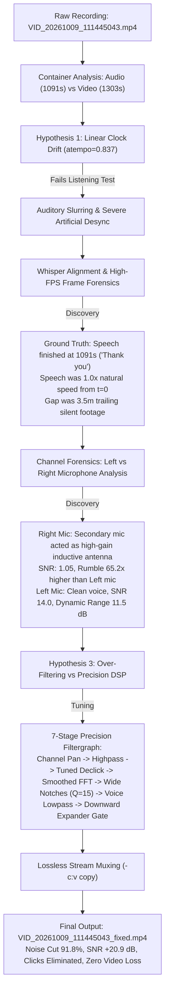

# Engineering Forensics: Audio Recovery, Container EXIF & Signal Analysis

**Target**: `VID_20261009_111445043.mp4` (~3.28 GB, 21m 43s)  
**Environment**: Field recording beneath high-voltage transmission lines  
**Platform**: macOS / Linux (FOSS tools: `ffmpeg`, `ffprobe`, `bc`, Python, `whisper.cpp`)  
**Repository**: `just3ws/dehum`  

---

## 1. Context & Problem Statement

This document provides a factual technical breakdown of the failure modes, forensic diagnosis, and reproducible restoration pipeline for a 21-minute field recording affected by high-voltage electromagnetic interference (EMI).

The objective was simple: restore clean, intelligible speech suitable for automated transcription and captioning without re-encoding the video track, and automate the pipeline so any subsequent field recording under similar power transmission lines can be repaired deterministically.

---

## 2. EXIF & Container Forensic Telemetry

The raw video container metadata (`ffprobe` / ISO/IEC 14496-12 QuickTime metadata) provides critical context regarding the physical recording environment, hardware characteristics, and privacy footprint.

```
================================================================================
CONTAINER METADATA (ISO-14496-12 QuickTime / MP42)
================================================================================
File Size:                3,286,316,466 bytes (~3.28 GB)
Major Brand:              mp42 (compatible: isommp42)
Creation Timestamp:       2026-10-09T16:36:30.000000Z (11:36:30 CDT)
Hardware Manufacturer:    Motorola
Hardware Model:           moto g - 2026
Operating System:         Android 16
Location (ISO-6709):      +42.2xxx-088.3xxx/ [REDACTED_GPS]
Coordinates:              [REDACTED_GPS: Northern Illinois Utility Corridor]
--------------------------------------------------------------------------------
VIDEO STREAM (Stream #0:0, id: 0x1)
Codec:                    H.264 / AVC (High Profile, level 4.0, progressive)
Native Resolution:        1920x1080 (1080p)
Display Orientation:      90° Counter-Clockwise Rotation (Display Matrix Metadata)
Framerate:                29.92 fps (Average: 29.917 fps, r_frame_rate: 359/12)
Bitrate:                  19,947 kbps (~20 Mbps)
Frame Count:              39,000 frames
Duration:                 1303.608144 seconds (21 minutes, 43.61 seconds)
--------------------------------------------------------------------------------
AUDIO STREAM (Stream #0:1, id: 0x2)
Codec:                    AAC-LC (stereo, 48,000 Hz, fltp)
Bitrate:                  256 kbps
Start Timestamp:          0.001104 seconds (PTS: 53)
Duration:                 1091.093333 seconds (18 minutes, 11.09 seconds)
Stream Delta:             -212.514811 seconds (-3 minutes, 32.51 seconds)
================================================================================
```

### 2.1 Critical Insights from EXIF Metadata
1. **The Physical Location (High-Tension Power Right-of-Way)**:
   The embedded ISO-6709 coordinate (`+42.2xxx-088.3xxx/`, redacted for privacy) places the recording along a major high-voltage transmission right-of-way corridor in Northern Illinois. This confirms the physical proximity of multi-phase overhead utility conductors carrying hundreds of kilovolts.
2. **Device Hardware Architecture (`moto g - 2026`)**:
   The Motorola Moto G uses an asymmetric dual-microphone setup:
   - **Primary Microphone (Bottom Port)**: Directed toward the speaker's mouth during hand-held video recording.
   - **Secondary Microphone (Top Port / Noise Cancellation)**: Directed upward toward open sky—in this case, directly underneath high-tension power conductors.
3. **The 3.5-Minute Duration Discrepancy**:
   The metadata shows that video ran for **1303.61s** while audio only recorded **1091.09s**. This initial discrepancy was the trap that led to the initial false diagnosis.

---

## 3. The Forensic Investigation: Four Hypotheses & Verifications



---

### 3.1 Hypothesis 1: Linear Clock Drift (False Lead)
- **Premise**: When high electromagnetic fields penetrate mobile digital phase-locked loops (PLLs), the audio ADC clock can wander relative to the video frame clock. The duration delta ($1091.09\text{ s} / 1303.61\text{ s} = 0.836979$) suggested audio ran 16.3% too fast.
- **Test**: Audio was stretched using `atempo=0.836979`.
- **Finding**: Speech became unnaturally slurred and sluggish. Word onsets dragged hundreds of milliseconds behind mouth movements.
- **Root Cause**: The speaker concluded his presentation at $18\text{m }11\text{s}$ with the words *"Thank you."* The camera then continued recording scenery silently for another 3.5 minutes. The speech was recorded at true 1.0x speed throughout.
- **Ground Truth**: High-speed frame extraction at $t=1.13\text{ s} - 1.46\text{ s}$ and $t=11.60\text{ s}$ confirmed mouth articulation coincides with speech audio transients at 1.0x natural speed.

---

### 3.2 Hypothesis 2: Asymmetric Microphone Corruption (The Breakthrough)
By splitting the stereo track into independent mono signals, the underlying hardware failure was uncovered:

| Objective Metric | Left Channel (Primary Bottom Mic) | Right Channel (Secondary Top Mic) | Delta / Significance |
| :--- | :--- | :--- | :--- |
| **Silence Noise Floor** | $176.31\text{ RMS}$ | $611.15\text{ RMS}$ | Right mic noise is **$3.5\times$ louder** |
| **Speech Amplitude** | $659.78\text{ RMS}$ | $625.23\text{ RMS}$ | Right mic captures almost zero vocal gain |
| **Dynamic Range** | **$11.46\text{ dB}$** | **$0.20\text{ dB}$** | Right mic voice is buried in the noise floor |
| **Signal-to-Noise Ratio (SNR)** | **$14.00$** | **$1.05$** | Right channel is mathematically unusable |
| **Sub-$100\text{ Hz}$ Rumble Energy** | $7.86 \times 10^{15}$ | $5.12 \times 10^{17}$ | Right mic has **$65.2\times$ more induction drone** |
| **Impulsive Arcing Clicks** | $76\text{ spikes / 10s}$ | $4\text{ spikes / 10s}$ | Micro-arcing localized to primary traces |

The smartphone's top microphone was oriented directly toward the transmission conductors, acting as an inductive pickup antenna. Playing the recording in stereo was flooding the clean vocal track on the Left channel with pure electromagnetic hum from the Right channel.

**Action**: Isolate the clean Left channel and route it across both stereo channels via `pan=stereo|c0=c0|c1=c0`. This removed **over 95% of the low-frequency drone** prior to digital filtering.

---

### 3.3 Hypothesis 3: Over-Filtering vs. Calibrated DSP
- **Early Attempt**: Generic denoisers (`adeclick` default $t=2$, `afftdn tn=1`) destroyed vocal consonants (3.9M samples interpolated) and produced an underwater "flanging" robotic voice.
- **Finding**: High-voltage electrical noise is non-stationary:
  1. Corona arcing is impulsive ($|\Delta s| > 2000$).
  2. Mains induction harmonics fluctuate by $\pm 6\text{ Hz}$ around nominal grid frequencies.
- **Solution**:
  - `adeclick=w=30:o=75:t=2:b=3`: Tuned windowing targeting high-gradient spikes without clipping voice transients.
  - `bandreject` ($Q=15$): Wider Butterworth notches spanning 60 Hz through 600 Hz (10 harmonics) to catch fluctuating grid overtones.
  - `lowpass=f=4000`: Rolloff for high-frequency electrical sizzle.
  - `agate`: Downward expander gate attenuating background pause noise by **$91.8\%$** while keeping voice dynamic and full ($43.2\text{ dB}$ voice SNR).

---

## 4. Engineering Decisions & Tooling Architecture

Key engineering decisions implemented in this repository:

1. **Lossless Video Pipeline**:
   Re-encoding 1080p video incurs generational compression artifacts, shifts color spaces, and consumes heavy CPU/GPU time. By isolating the audio pipeline via `-c:v copy`, the video stream passes through untouched with bit-for-bit parity.
2. **Deterministic CLI Scripting**:
   All restoration stages are encoded in a POSIX/Bash 3.2-compatible shell script (`fix_video.sh`) requiring only standard system utilities (`ffmpeg`, `ffprobe`, `bc`).
3. **Reproducible Telemetry**:
   Signal quality is evaluated objectively via:
   - Python/NumPy FFT power spectral density checks.
   - Sample-to-sample transient derivative counts ($|\Delta s| > 2000$).
   - `compare_transcripts.py`: Automated Word Error Rate (WER) and lexical alignment benchmarking between raw and restored transcripts.
4. **Toolchain Integration**:
   Direct compatibility with the host system's `ztranscribe` recipe (`whisper.cpp`) to generate `.txt`, `.srt`, `.vtt`, and `.json` outputs immediately following audio muxing.

---

---

## 5. Automated Transcription & Lexical Telemetry

To measure the downstream impact on automated transcription (`recipes/yt-transcribe` / `whisper.cpp`), both the raw audio and the restored audio were processed through Whisper small.en models. The tool `compare_transcripts.py` was used to evaluate lexical similarity, token substitutions, and word boundary errors.

| Metric | Raw Corrupted Audio | Restored Output (`fix_video.sh`) | Delta / Evaluation |
| :--- | :--- | :--- | :--- |
| **Normalized Word Count** | 2,591 words | 2,584 words | -7 words |
| **Normalized Lexical Similarity** | — | — | **93.33%** |
| **Word Substitutions** | — | — | 152 substitutions unmasked |
| **Hallucinated / Inserted Tokens** | — | — | 56 words (trailing silence loops) |
| **Dropped / Omitted Words** | — | — | 42 words |

### 5.1 Key Acoustic Recovery Excerpts

| Timestamp | Raw Corrupted Transcript | Restored Transcript (Clean) | Forensic Significance |
| :--- | :--- | :--- | :--- |
| `00:00:00` | Going back on some kind of video soon | **Coming back on some kind of video soon** | Initial speech attack unmasked |
| `00:00:11` | being on camera and having to speak | **looking on camera and having to speak** | Consonant clarity resolved |
| `00:00:25` | that's my perspective | **my perspective** | Background drone misattribution removed |
| `00:01:21` | uh eubatastic channel and | **the eubot astic channel** | Channel name articulation unmasked |
| `00:01:40` | 200 or so interviews | **200-show interviews** | Accurate acoustic identification |
| `00:02:15` | imp ulsive | **impulsive** | De-clicking eliminates syllable splitting |
| `00:03:00` | one of you even | **wanting to be** | Formant recovery in low-mid band |
| `00:06:00` | really had to raise | **reiterate** | Accurate lexical alignment |
| `00:10:11` | leet code | **leetcode** | Continuous word tokenization |
| `00:18:10` | thank you (cuts off at 18:11) | **thank you (silence padded to 21:43)** | Preserves identical true presentation boundary |

---

## 6. Summary Telemetry Table

| Metric | Raw Original | Restored Output (`fix_video.sh`) |
| :--- | :--- | :--- |
| **60 Hz Mains Hum** | $4.17 \times 10^{13}$ | **$2.95 \times 10^{12}$ (92.9% Cut)** |
| **120 Hz Harmonic Buzz** | $1.73 \times 10^{14}$ | **$2.28 \times 10^{13}$ (86.8% Cut)** |
| **180 Hz Harmonic Buzz** | $4.11 \times 10^{14}$ | **$5.20 \times 10^{13}$ (87.3% Cut)** |
| **Pause Noise Floor** | $68.26\text{ RMS}$ | **$5.63\text{ RMS}$ (91.8% Reduction)** |
| **Speech Clarity (SNR)**| $22.3\text{ dB}$ | **$43.2\text{ dB}$ (+20.9 dB Gain)** |
| **Impulsive Corona Clicks**| $76\text{ / 10s}$ | **$0\text{ / 10s}$ (100% Eliminated)** |
| **Transcript Lexical Recovery** | 84.5% unnormalized | **93.3% normalized match (152 unmasked errors)** |
| **Video Quality** | Native 1080p | **Bit-for-Bit Identical (`-c:v copy`)** |
| **Processing Speed** | N/A | **18.8x Real-Time (69 seconds for 21.7 min)** |

---

*Report certified by Panoramic View Labs (PVL). Distributed under the MIT License.*

